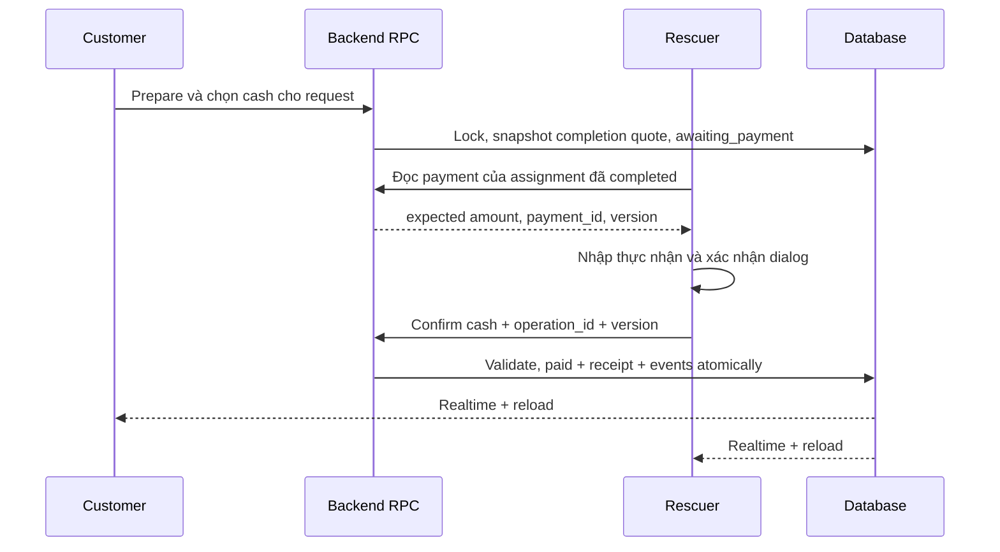

# Kế hoạch backend thanh toán Cứu Hộ 24/7

Ngày review: 2026-10-10. Trạng thái: **thiết kế để review, chưa triển khai**.

Phạm vi: `frontend/customer_app`, `frontend/rescuer_app`, `backend/supabase`, `admin_web`, `admin_web/backend/supabase`. Báo cáo dựa trên source đang có trong workspace, bao gồm thay đổi chưa commit của người dùng. Không truy cập database thực tế; không khẳng định migration đã được áp dụng lên môi trường nào. Không chạy SQL/test SQL, tạo migration, sửa code, deploy hoặc commit trong lần review này.

Đề xuất chính: payment là domain riêng; thanh toán sau khi dịch vụ hoàn tất; số tiền được snapshot từ báo giá mà `completion_quote_id` trỏ tới; tiền mặt do đối tác thu và tiền chuyển khoản vào tài khoản hệ thống được ghi nhận riêng. Chỉ trusted backend được xác nhận chuyển khoản. Các quyết định nghiệp vụ chưa có trong repo được đánh dấu **khuyến nghị cần chốt**, không coi là rule hiện hành.

Yêu cầu gửi đến bị ngắt ở mục OUTPUT, sau chuỗi “1. Backend hiện”. Tài liệu bao phủ các mục 1–20 đã nhận đầy đủ và bổ sung quyết định cần chốt, thứ tự triển khai, tiêu chí nghiệm thu.

## 1. Backend hiện tại và bằng chứng trong repo

### 1.1. Inventory migration và nguồn cần đối chiếu

Các đường dẫn bên dưới tính từ thư mục chứa báo cáo. Tên function/trigger là mốc tìm kiếm ổn định trong file.

| Nguồn | Kết quả review liên quan thanh toán |
|---|---|
| [Initial customer rescue](../backend/supabase/migrations/202609300001_initial_customer_rescue.sql) | `customer_profiles`, `rescue_requests`; `customer_id`, `provider_id`, `quoted_price integer >= 0`; request chỉ cho customer SELECT, tạo/hủy qua RPC. |
| [Customer tracking](../backend/supabase/migrations/202610010001_customer_tracking.sql) | Chuyển `assisting` thành `in_progress`; trigger kiểm soát transition; `request_status_events`; publication `supabase_realtime` chứa `rescue_requests`. |
| [Request photos](../backend/supabase/migrations/202610010002_customer_request_photos.sql) | Bucket riêng tư, reservation/complete RPC, giới hạn chủ sở hữu; không có chứng từ thanh toán. |
| [Customer vehicles](../backend/supabase/migrations/202610010003_customer_vehicles.sql) | Mở rộng vehicle kind, RPC tạo request khóa xe thuộc customer; không có payment amount. |
| [Saved addresses](../backend/supabase/migrations/202610010004_customer_saved_addresses.sql) | CRUD owner-only, không phải settings hệ thống. |
| [Customer reviews](../backend/supabase/migrations/202610010005_customer_request_reviews.sql) | Review chỉ yêu cầu request `completed`; không yêu cầu `paid`. |
| [Rescuer foundation](../backend/supabase/migrations/202610020001_rescuer_backend_foundation.sql) | Assignment, quote revision, completion quote, RPC receipts, consistency triggers, profile/vehicle verification, private storage. Nguồn chính để thiết kế payment. |
| [Admin foundation](../admin_web/backend/supabase/migrations/202610040001_admin_backend_foundation.sql) | Admin role, audited mutation, views; giá trị báo giá không phải tiền đã thu; chưa có payment/settings ledger. |
| [Display codes](../admin_web/backend/supabase/migrations/202610050001_display_codes.sql) | KH/DT/CH/BG/AD, sequence bigint, mã bất biến và unique; mở rộng DTO, views và customer code RPC. |
| [Manual location feed](../backend/supabase/migrations/202610050002_rescuer_manual_location_feed.sql) | Thay discovery/claim eligibility cho request địa chỉ nhập tay, không thay quote/payment/completion. |

Hai thư mục migration cùng tham chiếu các bảng `public` của một shared backend; không thiết kế hai payment database độc lập. Cần một thứ tự migration chung khi triển khai. Thư mục `backend/supabase/functions` hiện chỉ có `.gitkeep`; chưa có Edge Function thanh toán. Chưa thấy provider, webhook, payment table/RPC, settlement ledger hay settings table trong các migration được review. Không đọc file chứa credential để tìm provider.

Tài liệu cũ như [ADMIN_BACKEND.md](../admin_web/backend/supabase/docs/ADMIN_BACKEND.md) có mô tả ở thời điểm xây foundation; khi khác với frontend hiện tại, lấy code hiện tại làm bằng chứng. Kết quả test cũ trong repo không được xem là kết quả kiểm thử của plan này.

### 1.2. A — Nguồn tiền authoritative

`rescuer_create_quote(p_assignment_id, p_items, p_note, p_expected_version, p_operation_id)`:

1. Xác thực rescuer và khóa profile/request/assignment; assignment phải `arrived` hoặc `in_progress`.
2. Server validate item chỉ gồm service code của request, quantity nguyên 1–100, unit price nguyên không âm; tối đa 20 item. Tính tổng ở server bằng bigint trung gian, giới hạn tổng tới 2.147.483.647 rồi lưu integer.
3. Chuyển quote cũ từ `issued` sang `superseded`, tạo revision mới; cập nhật `current_quote_id`, assignment version và `rescue_requests.quoted_price` cùng transaction.
4. Ghi assignment event và operation receipt. Giá do rescuer đề xuất, server validate/tính tổng; chưa có engine giá độc lập hoặc customer acceptance.

`rescue_quotes.total_vnd` là dữ liệu báo giá có nguồn gốc và revision. `rescue_requests.quoted_price` là bản sao phục vụ contract customer. Trigger deferred `private.rescuer_check_consistency` buộc bản sao khớp current issued quote khi assignment tồn tại. `admin_service_catalog.base_price numeric(14,2)` chỉ là giá gợi ý; không dùng làm tiền phải thu. Giá hardcode trong UI cũng không authoritative.

`rescuer_update_job_status(..., 'completed', ...)` yêu cầu current quote `issued`, gán `completion_quote_id=current_quote_id`, ghi thời gian hoàn tất và đồng bộ `quoted_price`. Trigger quote bảo vệ nội dung báo giá khỏi sửa/xóa; chỉ cho `issued -> superseded`. Completion consistency buộc completion quote bằng current quote. RPC tạo quote không hoạt động sau completed.

**Kết luận cho payment:** lấy `rescue_quotes.total_vnd` qua `assignment.completion_quote_id`, lưu `quote_id` và snapshot amount/currency. Kiểm tra request/assignment/quote cùng danh tính và `quoted_price` khớp; nếu lệch thì fail closed, không tự chọn một giá để thu. Request legacy không có assignment/completion quote chưa đủ điều kiện tự tạo payment.

### 1.3. B — Khi nào hiện được phép thanh toán?

**Hiện chưa có rule backend cho phép thanh toán**, vì chưa có payment domain. Không thể kết luận accepted/in_progress/completed đã được quyền trả tiền từ một UI mock.

Request state machine: `searching -> accepted -> arriving -> in_progress -> completed`; có các nhánh hủy được trigger cho phép từ state chưa kết thúc. Customer cancel RPC chỉ cho `searching/accepted`; admin cancel chỉ `searching/accepted/arriving`. Assignment có `accepted -> en_route -> arrived -> in_progress -> completed`; `en_route` và `arrived` cùng ánh xạ request `arriving`. Hoàn tất hiện chỉ cần current issued quote; không kiểm tra paid và không có quote status `accepted`.

### 1.4. C — Assignment có quyền thu tiền

`rescue_request_assignments.request_id` hiện unique: một request chỉ có một assignment, kể cả lịch sử; chưa có flow reassignment. `rescuer_id` FK tới `rescuer_profiles.user_id`; consistency trigger kiểm tra `rescue_requests.provider_id=assignment.rescuer_id`.

Payment phải gắn `assignment_id` cụ thể và snapshot rescuer từ assignment đó. Không lấy “rescuer online gần nhất”, `provider_id` do client truyền hoặc active job hiện tại của rescuer làm quyền thu tiền. Với phương án thanh toán sau completion, dùng assignment đã completed của chính request, dù rescuer đã nhận ca tiếp theo.

### 1.5. D — Quyền đọc hiện tại

| Chủ thể | Được đọc hiện tại | Giới hạn cần giữ |
|---|---|---|
| Customer | SELECT toàn row request của mình, gồm quoted_price/provider_id; profile/vehicle/address/photo/review của mình, request status events | Không SELECT trực tiếp assignment hoặc quote; `customer_request_display_codes(uuid[])` chỉ trả quote code cho request của caller, batch tối đa 100. |
| Rescuer | Owner SELECT profile, document metadata, vehicle, capability, online/location | Assignment/quotes/events không có SELECT grant/policy client; qua RPC DTO. Active job có contact/address/GPS khi đúng assignment và approved. History chỉ trả DTO được giới hạn; quote items/note không tự lộ sau kết thúc. |
| Admin | View và RPC theo `admin_profiles.role/status`, có `is_admin()` và `has_admin_role()` | Không tự có toàn quyền shared base tables. Quotes dành cho super_admin/finance. Request view chỉ super_admin/operator/support; finance-only không đọc được view này. |

`admin_rescue_requests_view.quote_amount` còn bị gate super_admin/finance bên trong gate tổng super_admin/operator/support: finance-only không nhận row, operator/support nhận amount NULL. Payment module cần contract finance riêng, không join frontend qua request view rồi kỳ vọng finance được đọc.

### 1.6. E — Frontend, realtime, audit, storage, settings

| Nguồn | Hiện trạng |
|---|---|
| [Customer main](../frontend/customer_app/lib/main.dart), [PaymentScreen](../frontend/customer_app/lib/screens/payment_screen.dart) | PaymentScreen là mock: số tiền 170.000, mã RQ mẫu, nhiều phương thức cũ, nút chỉ navigate history. Route `/payment` không được đăng ký trong `main.dart` hiện tại. Không phải flow thanh toán thật. |
| [Customer service](../frontend/customer_app/lib/services/supabase_service.dart), [tracking hiện tại](../frontend/customer_app/lib/screens/new_tracking_screen.dart) | Watch `rescue_requests` UPDATE với filter id; reload snapshot khi subscribe/reconnect; gắn vòng đời màn hình/auth. Không có payment subscription. |
| [Rescuer controller](../frontend/rescuer_app/lib/app/rescuer_controller.dart), [finance UI](../frontend/rescuer_app/lib/screens/preparation/job_finance_section.dart) | Tạo quote và complete dùng RPC/version/operation id. Completion xóa active job, chuyển tab lịch sử. Refresh ca/feed bằng timer 45 giây; chưa có realtime payment. |
| [Admin data hook](../admin_web/src/hooks/useAdminData.ts) | Subscribe table changes, debounce 300 ms, polling 60 giây và focus reload. View quyền admin không tự cấp quyền nhận realtime base table. |
| [Dashboard](../admin_web/src/pages/DashboardPage.tsx) | UI đã ghi “Giá trị báo giá hôm nay”, backend `revenue_basis=current_issued_quotes_not_payments`; không được tái diễn giải thành paid revenue. `admin_customers_view.total_spent=0` là placeholder. |
| [Settings](../admin_web/src/pages/SettingsPage.tsx) | Chỉ đọc/placeholder, chưa API lưu. Mock settingsDefaults không phải cấu hình backend. |

Audit hiện có: `request_status_events` lưu transition request nhưng không actor; `rescuer_assignment_events` lưu version/actor và quote-issued/status; `private.rescuer_rpc_receipts` chống retry theo rescuer/operation_id/hash; `admin_audit_logs` ghi thao tác quản trị, writer internal không grant client. Các bảng này không thay được payment audit/inbox.

Realtime migration hiện chỉ thêm `rescue_requests` vào publication. Payment cần publication và quyền SELECT/RLS mới hoặc private Broadcast được authorize riêng. Không giả định subscription hiện tại đã đủ.

Storage hiện có `rescue-request-photos` và `rescuer-documents` riêng tư. QR có thể render từ payload nên không cần bucket mới. Ảnh chụp biên lai không phải bằng chứng bank paid; nếu sau này cần upload hỗ trợ, thiết kế bucket/policy riêng, không mở các bucket hiện có.

## 2. Các quyết định nghiệp vụ được khuyến nghị

| Quyết định | Khuyến nghị cho phiên bản đầu | Tình trạng |
|---|---|---|
| Thời điểm thu | Request và assignment đều completed, có completion quote | Cần chốt; không phải rule payment hiện có |
| Tiền mặt lệch giá | Chỉ xác nhận settled khi received = expected; lệch thì không paid, chuyển hỗ trợ có reason/audit | Cần chốt; không cho frontend tự override |
| Quote bằng 0 | Schema cho >=0, nhưng không tự tạo QR/thu 0; trả `ZERO_AMOUNT_REQUIRES_POLICY` đến khi chốt miễn phí/no-payment-required | Repo cho quote 0, chưa có rule settlement 0 |
| Đổi phương thức | Cho cash -> bank trước paid; bank -> cash chỉ trước khi QR/reference được phát hành. Sau phát hành cần trusted reconciliation/cancel workflow | Cần chốt; QR cũ không thể bị thu hồi khỏi ảnh đã lưu |
| Partial/split payments, tip | Chưa hỗ trợ v1; không cộng nhiều chuyển khoản nhỏ để tự paid | Ngoài nghiệp vụ hiện được mô tả |
| Refund | Chỉ trusted workflow có bằng chứng hoàn tiền; không sửa paid thành unpaid để thu lại | Cần chốt người thực hiện, nguồn tiền và khả năng provider |
| Suspended rescuer còn cash chưa thu | Mặc định không cho tạo xác nhận mới; giữ quyền đọc lịch sử tối thiểu, admin xử lý ngoại lệ | Cần chốt để tránh bỏ quên công nợ sau completed |

## 3. Domain model: payments và dữ liệu hỗ trợ

### 3.1. Một payment cho một nghĩa vụ thanh toán

Khuyến nghị v1 `payments.request_id UNIQUE`: một nghĩa vụ thanh toán cho một request và một completion quote. Retry, QR retry, đổi method chưa thu không tạo payment khác. Không xóa rồi tạo lại để reset trạng thái. Nếu cần nhiều đợt thu hoặc điều chỉnh giá sau hoàn tất, phải bổ sung payment order/attempt/adjustment domain, chưa tự mở rộng nghiệp vụ đó.

`payments` chỉ chứa dữ liệu an toàn cho các bên tham gia đọc. Transaction provider, payload hash và thông tin xử lý webhook nằm bảng private. RLS là row-level, không phải cơ chế che metadata theo field; tránh đặt dữ liệu chỉ admin được xem vào row sẽ phát realtime cho customer/rescuer.

### 3.2. Fields đề xuất

| Field | PostgreSQL type/nullability | Rule và mục đích |
|---|---|---|
| id | uuid PK NOT NULL, server default | Identity nội bộ, không suy ra quyền từ UUID |
| payment_code | text NOT NULL UNIQUE | TT-000001, server cấp, bất biến |
| request_id | uuid NOT NULL UNIQUE | FK rescue_requests, ON DELETE RESTRICT |
| assignment_id | uuid NOT NULL | Gắn assignment chịu trách nhiệm thu |
| customer_id | uuid NOT NULL | Server lấy từ request; FK auth.users RESTRICT |
| rescuer_id | uuid NOT NULL | Server lấy từ assignment; FK rescuer_profiles RESTRICT |
| quote_id | uuid NOT NULL | Completion quote cụ thể; FK cùng assignment |
| amount_expected | bigint NOT NULL CHECK >= 0 | Snapshot VND; tuyệt đối không float |
| amount_received | bigint NULL CHECK >= 0 | NULL khi chưa settle; chỉ ghi số được phân bổ cho nghĩa vụ này; mismatch bank giữ ở private transaction |
| currency | text NOT NULL DEFAULT VND, CHECK = VND | Phù hợp rescue_quotes hiện tại; chưa đa tiền tệ |
| method | text NULL, CHECK cash/bank_transfer | NULL ở pending chưa chọn method hoặc cancelled từ pending; không gán method giả khi hủy |
| status | text NOT NULL DEFAULT pending | CHECK allowlist các trạng thái mục 3.4 |
| version | bigint NOT NULL DEFAULT 1, CHECK > 0 | Chống client stale/out-of-order, tăng khi payment thật sự thay đổi |
| cash_received_by | uuid NULL, FK rescuer_profiles RESTRICT | Bắt buộc bằng rescuer_id khi cash paid/refunded |
| cash_received_at | timestamptz NULL | Server time của xác nhận cash; lưu cả khi đã refund |
| paid_at | timestamptz NULL | Server time payment lần đầu settled, không xóa khi refund |
| verified_at | timestamptz NULL | Bank trusted verification; cash NULL để tránh hiểu là ngân hàng đã xác minh |
| failed_at/cancelled_at/refunded_at | timestamptz NULL | Dấu mốc server, giữ lịch sử; event là nguồn lịch sử đầy đủ |
| created_at/updated_at | timestamptz NOT NULL | DEFAULT clock_timestamp(), trigger/RPC server quản lý |
| failure_code/cancellation_reason_code | text NULL có allowlist | Lý do an toàn cho UI, không chứa raw provider error |

Timestamps của ngân hàng như `provider_occurred_at` khác server `paid_at/verified_at`, đặt trong transaction private để không nhận timestamp client làm thời gian audit.

Chọn bigint vì VND nguyên đồng và tránh giới hạn integer ở domain mới. Không đổi type quote cũ trong plan. Trong v1 amount snapshot không vượt giới hạn quote hiện tại; tổng dashboard có thể vượt JavaScript safe integer nên API money/aggregate trả chuỗi số thập phân nguyên, Flutter/TypeScript parse có kiểm soát. `numeric(20,0)` cũng đúng về độ chính xác nhưng không cần cho từng payment v1; không dùng PostgreSQL `money` hoặc numeric có phần lẻ cho VND hiện tại.

### 3.3. Constraints, FK, indexes và fields không nên gom vào payments

- Composite FK `(assignment_id, request_id, rescuer_id)` -> assignment `(id, request_id, rescuer_id)` đã có UNIQUE; `(quote_id, assignment_id)` -> quote `(id, assignment_id)` đã có UNIQUE. Thêm candidate key `(id, customer_id)` trên request và composite FK `(request_id, customer_id)` để khóa ownership ở DB, không chỉ ở RPC. Kiểm tra completion quote/amount bằng trusted function và trigger consistency vì CHECK không dùng để truy vấn bảng khác.
- Tất cả FK payment/event/transaction có dữ liệu tài chính dùng RESTRICT, không CASCADE xóa lịch sử khi xóa request/user. Việc này có thể chặn luồng xóa auth user hiện dùng cascade ở customer; phải có quy trình vô hiệu hóa/anonymize riêng được review trước khi thêm chức năng xóa tài khoản.
- Index `(customer_id, created_at DESC, id)`, `(rescuer_id, created_at DESC, id)`, `(status, created_at DESC, id)`, `(method, paid_at DESC, id)` và index assignment/quote FK theo nhu cầu query. Không tạo mọi tổ hợp filter; đo execution plan ở giai đoạn triển khai.
- Identity, quote, amount_expected, currency bất biến sau insert. Method chỉ đổi qua transition function khi chưa có thu tiền/QR lock; không đổi sau paid/refunded. Không DELETE payment từ client/admin route.
- `quote_code` không cần lặp trên payment: join immutable quote theo quote_id. `payment_code`, `quote_id`, amount snapshot đủ audit; có thể lưu revision/code trong event snapshot để đọc thuận tiện.
- `transfer_content`, provider, QR expiry và bank display snapshot thuộc một **bank intent**; `provider_transaction_id`, bank_reference thuộc **giao dịch thực nhận**. Không để một cột transaction trên payments làm mất giao dịch mismatch/đến muộn/thứ hai. Admin DTO có thể project các field này từ các bảng hỗ trợ.

### 3.4. State machine payment

| Từ -> đến | Writer hợp lệ | Điều kiện |
|---|---|---|
| không có -> pending | customer_prepare_payment | Completed, ownership/quote hợp lệ, amount >0 theo khuyến nghị v1 |
| pending -> awaiting_payment | customer_select_payment_method | Method enable, bank config sẵn sàng nếu chọn bank |
| awaiting_payment -> awaiting_payment | Method switch RPC | Chưa settled/verifying, obey bank intent rule, tăng version và audit nếu method đổi |
| awaiting_payment -> paid | rescuer cash RPC | Cash đúng assignment, received=expected |
| awaiting_payment -> verifying | Trusted bank processor | Có giao dịch đã xác thực nguồn và cần xử lý tiếp |
| verifying -> paid | Trusted bank processor | Đúng beneficiary, currency, amount, reference, giao dịch credit đã confirmed |
| awaiting_payment/verifying -> failed | Trusted processor | Thất bại nghĩa vụ/intent đã xác định; không dùng network timeout làm bằng chứng thất bại tiền |
| pending/awaiting_payment -> cancelled | Trusted cancel workflow | Chưa nhận tiền; nếu đã phát QR phải reconcile trước và giữ reference tombstone |
| paid -> refunded | Trusted refund completion | Chỉ khi hoàn đủ tiền có bằng chứng; không xóa paid_at/received |

Callback hợp lệ có thể xác minh và settle trong một transaction: ghi event detected/verifying/verified rồi commit paid; frontend có thể chỉ thấy paid, không bảo đảm nhìn thấy trạng thái verifying thoáng qua. Nếu cần xử lý bất đồng bộ thì commit verifying, worker retry bền vững.

`failed/cancelled/refunded` là kết thúc thông thường. Không cung cấp customer reset. Retry giao tiếp hoặc QR generation failure giữ awaiting_payment; retry lỗi nghiệp vụ terminal cần trusted recovery procedure, khóa row, kiểm tra chưa có settlement, reason và audit. Không kích hoạt recovery/refund route khi rule chưa chốt.

CHECK rõ NULL: pending => method IS NULL và chưa nhận tiền; awaiting_payment/verifying/paid/failed/refunded => method IS NOT NULL. Cancelled được giữ method NULL nếu hủy từ pending, còn nếu đã chọn thì giữ method lịch sử; transition function và event kiểm soát nguồn trạng thái. Paid/refunded => amount_received IS NOT NULL AND amount_received=amount_expected AND paid_at IS NOT NULL. Chưa từng paid => amount_received/paid_at/cash_received_* NULL. Cash settled => cash_received_by IS NOT NULL AND cash_received_by=rescuer_id và cash_received_at NOT NULL, verified_at NULL; bank settled => cash fields NULL, verified_at NOT NULL và có transaction đã apply qua consistency trigger. Refunded => refunded_at NOT NULL; failed/cancelled tương ứng có timestamp. Không dùng `CHECK (amount_received=amount_expected)` một mình vì NULL có thể vượt CHECK.

### 3.5. Các bảng hỗ trợ tối thiểu cho bank reliability

| Bảng | Fields/constraints chính | Quyền |
|---|---|---|
| private.payment_bank_intents | id uuid PK; payment_id FK RESTRICT; intent_version bigint; reference text UNIQUE; provider/merchant_scope; beneficiary_config_id/version; snapshot tài khoản nhận/amount/currency; state preparing/ready/closed; QR data cần thiết; issued_at/expires_at/closed_at timestamptz; UNIQUE(payment_id,intent_version), một intent mở/payment | Trusted server; customer chỉ lấy QR DTO đúng payment qua endpoint |
| private.bank_transactions | id uuid PK; provider, merchant_scope, provider_transaction_id text NOT NULL; UNIQUE(provider,merchant_scope,provider_transaction_id); bank_reference optional; reference đã normalize; amount bigint >=0; currency; direction credit/debit; beneficiary identity; provider_occurred_at; verified_at; payment_id nullable; intent_id nullable; disposition received/applied/unmatched/amount_mismatch/conflict/late; reason code | Trusted insert/process; finance đọc projection qua RPC. Unknown reference vẫn lưu được vì payment_id NULL |
| private.payment_webhook_receipts | id uuid; provider/scope/event_id nếu có, UNIQUE composite khi event_id không NULL; body digest; received_at; verification result; processing_state; attempts/next_retry_at; transaction_id nullable; sanitized error code | Inbox durable cho delivery đã xác thực; không public realtime |
| private.payment_rpc_receipts | actor_id, operation_id UUID, operation_name, payload_hash, resource_id, committed_at; PK(actor_id,operation_id) | Dùng cho customer/admin mutation; rescuer có thể tái sử dụng receipts hiện có với namespace operation mới |

Bank transaction ID unique theo provider và merchant scope, không giả định toàn bộ nhà cung cấp chia sẻ namespace. Có thêm partial UNIQUE(payment_id) khi disposition=applied để một nghĩa vụ chỉ phân bổ một bank receipt; consistency guard không cho apply khi payment đã cash-paid. Nếu provider không có transaction identity bền vững, chưa đủ điều kiện bật auto-paid.

Không cần payment attempts tổng quát cho cash v1. Bank intents/inbox cần thiết để giữ reference cũ và nhận callback lặp, không phải lý do tự hỗ trợ trả góp. Tách transaction thực tế khỏi payment giúp ghi nhận tiền thực vào ngân hàng dù chưa phân bổ được cho request.

Trước khi bật refund cần thêm `private.payment_refunds`: id uuid PK, payment_id FK RESTRICT, amount bigint NOT NULL CHECK >0, currency VND, source_holder system/rescuer, status requested/processing/succeeded/failed, requested_by uuid, operation_id uuid, reason_code, provider/refund_transaction_id nullable, evidence_reference internal, requested_at/completed_at server timestamps. Unique operation key và unique provider refund identity; một full refund thành công/payment trong v1. Cash refund cần actor/evidence từ quy trình đã chốt; bank refund cần trusted provider confirmation. Amount refund không vượt amount_received, khóa payment trước refund, chỉ khi succeeded đủ tiền mới chuyển payment refunded. Không gọi timestamp/refunded event là bằng chứng chuyển tiền nếu chưa có refund receipt. Hoàn lại một giao dịch bank unallocated là ngoại lệ đối soát gắn bank_transaction_id, không giả tạo payment cho request không liên quan.

## 4. Payment events và audit

`payment_events`: id uuid PK; payment_id uuid NOT NULL FK RESTRICT; request_id uuid NOT NULL; event_type text allowlist; actor_type text (`customer/rescuer/admin/provider/system`); actor_id uuid nullable; old_status/new_status text nullable có allowlist; amount bigint nullable CHECK >=0; metadata jsonb NOT NULL DEFAULT object; created_at timestamptz server; operation_id uuid nullable; payment_version bigint NOT NULL; event_sequence bigint NOT NULL. UNIQUE(payment_id,event_sequence), index `(payment_id,event_sequence)` và `(request_id,created_at,id)`.

Nếu giữ request_id để query, thêm FK composite `(payment_id,request_id)` -> payments candidate key tương ứng; không để event trỏ request khác payment. actor_id phải từ auth context cho human actor, không từ args; provider/system dùng NULL và định danh nguồn trong metadata allowlist. FK human actor có thể RESTRICT để giữ attribution; quy trình anonymize cần thiết kế riêng, không tự xóa audit.

| Event | Lúc ghi |
|---|---|
| payment_created | Tạo payment và snapshot quote |
| payment_method_selected | Chọn/đổi method thật, ghi old/new method |
| cash_confirmation_started | Chỉ ghi khi backend thực sự nhận thao tác xác nhận; mở dialog frontend không phải sự kiện trusted |
| cash_received | Một lần cùng transaction cập nhật paid |
| bank_qr_created | Intent/reference/QR sẵn sàng lần đầu; reload QR không tạo thêm event |
| bank_transfer_detected / bank_transfer_verifying | Giao dịch có nguồn đã verified, liên kết được payment |
| bank_payment_verified | Transaction đã apply, paid ghi cùng transaction |
| payment_failed / payment_cancelled / payment_refunded | Transition tương ứng có nguyên nhân |
| payment_method_change_rejected / bank_transfer_conflict / payment_recovery_started | Sự kiện ngoại lệ cần thiết; chỉ server tạo, metadata tối thiểu |

Customer/rescuer không INSERT/UPDATE/DELETE; admin cũng không chỉnh lịch sử. Trigger chống UPDATE/DELETE và writer function private; mutation payment và audit cùng DB transaction. Replayed success không ghi lại cash_received/bank_payment_verified. Sai signature không tạo event giả cho payment; ghi security log tối thiểu riêng. Unknown reference ghi inbox/transaction exception, không gán đại vào payment.

Nếu muốn giữ audit một thao tác bị từ chối, không INSERT event rồi RAISE khiến transaction rollback mất log. Dùng kết quả lỗi có cấu trúc và commit event không đổi payment, hoặc server log riêng. `cash_confirmation_started` có thể cùng atomic transaction với cash_received; không cần RPC mở dialog gây thêm race/spam. Timeline customer/rescuer lấy projection sạch qua RPC, không mở toàn metadata.

## 5. Payment code và transfer reference

- `payment_code`: TT + sequence bigint server, định dạng `TT-` + ít nhất 6 chữ số, không truncate sau 999999; dùng quy tắc format/display-code hiện có. UNIQUE, immutable, client không consume sequence. Sequence có gap khi rollback là bình thường.
- `transfer_content`: reference do server sinh riêng cho bank intent, ví dụ prefix môi trường 3–5 ký tự + 16 ký tự uppercase Crockford base32 ngẫu nhiên (80 bit) + checksum tùy adapter. Tổng chiều dài phải vừa provider; UNIQUE DB và retry collision. Không nhúng tên, điện thoại hay địa chỉ.
- `provider_transaction_id`: ID thực của giao dịch do provider đã xác thực gửi/tra cứu, không lấy từ customer. Giữ nguyên case/format theo provider; không biến thành payment_code.
- CH code dùng hiển thị/join request, BG code dùng báo giá. Không dùng riêng CH làm transfer reference. Chống callback lặp bằng unique transaction/event identity; randomness của reference không thay signature verification.
- Normalize reference theo adapter đã test: giới hạn ASCII, case/space chỉ khi contract cho phép; exact token match, không fuzzy matching hoặc tìm CH tùy ý trong description. Hai reference match hoặc mô tả bị cắt => exception cần đối soát.
- Mỗi reference gắn vĩnh viễn payment/intent; không reuse cả khi expired/cancelled. Cấu hình prefix đổi chỉ áp dụng intent mới. Môi trường test và production phải khác namespace/tài khoản nhận.

## 6. Luồng CASH

Dialog hiển thị TT/CH/BG, expected và actual, cảnh báo xác nhận là đã nhận tiền thực tế. Client validation chỉ hỗ trợ UX. RPC tự lấy caller, request owner, assignment, completion quote và expected; không nhận customer_id/rescuer_id/amount_expected từ client.

Preconditions khuyến nghị: request.status=completed; assignment.state=completed; assignment/request/provider nhất quán; caller đúng assignment.rescuer_id và approved tại thời điểm tạo xác nhận mới; enable_cash và allow_cash_collection cho phép; payment cash awaiting_payment; không bank intent đã phát hành chưa reconcile, không bank verification đang chạy. Không bắt buộc rescuer online/GPS hoặc ca này vẫn là active job.

Chênh lệch tiền: v1 khuyến nghị **received phải bằng expected**. Thiếu/thừa không được tự paid hoặc âm thầm đổi expected. Người dùng cần nhập số tiền đã thu đúng với thực tế; nếu đã thu lệch ngoài đời, tạo case hỗ trợ có lý do và số tiền khai báo, chưa coi là settlement. Nếu doanh nghiệp muốn ghi nhận thu một phần/tiền thừa, bổ sung cash receipt ledger, amount allocated/change returned và quyền điều chỉnh trước khi bật; một field received không đủ cho các trường hợp đó.

Double submit/retry: operation_id cố định qua retry và payload hash; lock payment. Cùng key/payload trả lại payment hiện tại, changed=false. Cùng key khác payload => IDEMPOTENCY_CONFLICT. Payment đã cash-paid cùng actor/amount dù key khác => no-op, không event/receipt thu tiền thứ hai; payload khác hoặc đã bank-paid => conflict. Check ownership trước khi trả retry result, không để receipt bypass quyền đọc.

Admin label rõ: **CASH — đối tác đã thu trực tiếp**. `paid` nghĩa là nghĩa vụ khách đã được ghi nhận thanh toán; không có bank transaction, không tăng tiền hệ thống đã nhận.

## 7. Luồng BANK TRANSFER và QR

Customer chọn bank -> backend chuẩn bị intent/reference và snapshot tài khoản hệ thống -> QR DTO -> khách chuyển tiền -> provider callback/tra cứu trusted -> inbox -> đối chiếu giao dịch -> apply paid -> event/realtime. Customer “đã chuyển tiền” nếu có nút chỉ yêu cầu refresh/kiểm tra rate-limited, không tạo bank evidence hoặc set paid.

| Phương án | Đánh giá |
|---|---|
| QR tài khoản cố định không gắn số tiền/reference | Không đủ đối soát từng request; không chọn cho flow này |
| QR VietQR với amount/reference mỗi intent | Phù hợp hiển thị chuyển khoản; tạo QR tự nó không chứng minh ngân hàng đã nhận tiền |
| Banking/webhook provider | Phù hợp nếu có dữ liệu credit tài khoản hệ thống, xác thực nguồn, transaction ID bền vững, truy vấn/replay và xử lý retry |
| Payment gateway | Có thể dùng adapter; phải phân biệt gateway báo thanh toán thành công với tiền đã settlement vào tài khoản hệ thống. Không cộng tiền hệ thống đã nhận khi gateway mới authorize/capture mà chưa settlement |

Chưa chọn nhà cung cấp vì repo chưa tích hợp. Tiêu chí lựa chọn: hỗ trợ ngân hàng nhận, signature/auth tương đương, query transaction, merchant/account scope, reference không bị cắt, retry/out-of-order semantics, settlement visibility, rate limit, khả năng reconcile và sandbox. Với gateway settlement chậm, cần mở rộng settlement model trước khi đạt yêu cầu “tiền đã về hệ thống”.

VietQR.IO document API generate có amount nguyên và addInfo tối đa 25 ký tự; đây là giới hạn API cụ thể, không suy ra tất cả ngân hàng/provider đều giống nhau. Adapter phải kiểm chứng round-trip reference. [Tài liệu VietQR.IO](https://www.vietqr.io/generate/).

Contract `get_customer_payment_qr(p_request_id uuid)` là endpoint backend; nếu QR cần gọi provider, dùng Edge Function có user JWT, không gọi HTTP provider bên trong transaction đang khóa DB. Server authorize bằng JWT, gọi RPC reserve intent có quyền customer; gọi provider sau commit với idempotency key intent.id; finalize QR bằng server-only function so sánh version. Worker khôi phục intent preparing nếu process chết. Concurrent get dùng chung intent, không phát reference mới tùy tiện.

Return allowlist: payment_id, payment_code, request_id/request_code, quote_code, amount (chuỗi VND nguyên), currency, method, status, version, bank_display_name/bank_bin, account_name/account_number nhận công khai, transfer_content, qr_payload hoặc URL HTTPS đã kiểm soát host, expires_at nullable, server_time. Không trả API key, webhook secret, service role, raw provider payload hoặc tài khoản người chuyển.

Account/reference/amount được lấy từ intent đã snapshot; không lấy từ URL params của client. QR URL không có credential; ưu tiên payload render local để giảm rò metadata qua dịch vụ ảnh. `expires_at` mô tả hiệu lực intent theo provider/business rule, không bảo đảm ngân hàng sẽ từ chối chuyển khoản từ QR cũ. Expiry không chứng minh chưa có tiền; callback trễ phải vào luồng đối soát.

## 8. Webhook, xác minh và khả năng phục hồi

Khuyến nghị Edge Function `bank-payment-webhook` trong backend dùng chung; admin_web hiện là Vite frontend và SQL migrations, chưa có server runtime riêng cho webhook. Có thể chuyển adapter sang backend khác khi có runtime được vận hành; vẫn giữ DB transaction/contract như nhau.

1. Giới hạn method/content-type/body size và rate; lấy raw body trước parse để kiểm signature theo provider. Dùng secret server-side, so sánh constant-time khi phù hợp; kiểm signed timestamp/nonce theo retry semantics provider, key rotation có khoảng chuyển tiếp.
2. Provider thường không có Supabase user JWT. Endpoint callback cần cấu hình auth phù hợp riêng; nếu tắt verify_jwt ở callback thì bắt buộc xác thực provider trong handler. Không tắt auth của endpoint customer QR. [Supabase Edge Function auth](https://supabase.com/docs/guides/functions/auth), [function configuration](https://supabase.com/docs/guides/functions/function-configuration).
3. Nếu provider không ký, cần cơ chế trusted khác đủ mạnh và/hoặc server tra cứu lại transaction từ API provider. IP allowlist đơn lẻ hoặc biết reference không đủ auto-paid. Chưa xác minh nguồn thì không dùng payload để mutate payment.
4. Persist verified delivery vào inbox bằng event ID hoặc digest/idempotency phù hợp; không ACK thành công trước khi có bản ghi bền vững. Worker/inline processor dùng cùng contract; worker retry có backoff và dead-letter/admin exception queue.
5. Normalize theo adapter; kiểm event loại credit/settled thành công, tài khoản nhận/merchant, currency VND, exact reference, amount_expected và transaction ID. Không chỉ kiểm amount/reference; giao dịch debit hoặc vào tài khoản khác phải bị chặn.
6. Lock theo thứ tự mục 11, insert/dedupe bank transaction, kiểm payment và intent version/state, apply payment + transaction disposition + audit trong một DB transaction. Callback đã apply cùng identity/payload => no-op.
7. Cùng transaction ID nhưng amount/reference/beneficiary khác => conflict/security exception; không update bản ghi cũ để hợp thức hóa. Payment đã paid với transaction khác hoặc cash => ghi transaction conflict và đối soát, không settlement lần hai.
8. Wrong amount/unknown reference/late intent: lưu verified transaction và exception reason, **reject việc set paid**. ACK theo provider contract sau khi đã lưu durable; không trả lỗi retry vô hạn cho một mismatch nghiệp vụ không thay đổi. DB/network failure chưa lưu => retryable non-2xx theo contract provider. Invalid signature => 401/403, không lưu raw body không tin cậy vào payment audit.
9. Callback provider failed không được đảo paid về failed. Failure chỉ áp dụng đúng intent chưa settled; callback reordered phải kiểm trạng thái provider authoritative. Network timeout/QR generation failure không đồng nghĩa giao dịch thanh toán thất bại.
10. Job đối soát server định kỳ tra cứu giao dịch/checkpoint, overlap khoảng thời gian để không mất giao dịch đến muộn; đi qua cùng dedupe/apply path. Alert inbox lâu chưa xử lý, mismatch, late transfer, provider outage. Không dựa hoàn toàn vào callback một lần.

`service_role` hoặc secret server chỉ dùng trong Edge/worker; không đưa vào Flutter, Vite `VITE_*`, URL, log hay git. Function DB business logic ưu tiên `private.apply_verified_bank_transaction`. Với Supabase client/PostgREST không gọi được private schema: tạo wrapper public **chỉ GRANT EXECUTE service_role**, revoke PUBLIC/anon/authenticated, gọi helper private; hoặc dùng DB connection server với role hẹp. Không expose private schema chỉ để gọi RPC. `auth.uid() IS NULL` không phải bằng chứng trusted caller.

## 9. RLS và phân quyền đề xuất

Tạo bảng với RLS và revoke mặc định ngay cùng migration transaction, tránh khoảng thời gian bảng public chưa bảo vệ. Không dựa vào nút UI hoặc tên channel để authorize. Các RPC definer phải `SET search_path=''`, schema-qualify object, không dynamic SQL từ input; revoke EXECUTE PUBLIC mặc định, grant signature cụ thể.

| Đối tượng | SELECT payments | Mutation |
|---|---|---|
| anon | Không grant/policy | Không RPC payment |
| Customer | Policy customer_id=auth.uid(), identity đã bị FK/trigger bảo vệ; có thể thêm EXISTS own request như defense-in-depth | Prepare/select method qua RPC kiểm ownership; không direct INSERT/UPDATE/DELETE, không bank confirm |
| Rescuer | Policy rescuer_id=auth.uid() với snapshot assignment được composite FK bảo vệ | Cash confirm qua RPC đúng assignment; không bank confirm hoặc đổi owner/amount |
| Unrelated authenticated | Không row | Mọi lookup/mutation ID khác trả not-found/forbidden thống nhất |
| Admin active | Super_admin/finance đọc toàn bộ payments theo has_admin_role | Sensitive RPC gate role + lock membership; không direct write |
| Operator/support/partner_reviewer | Khuyến nghị không SELECT full payment base row; operator/support có summary RPC riêng nếu cần | Không set paid/refund; reviewer không có nghiệp vụ payment |
| Blocked admin | Không được quyền admin | Không mutation; nếu cùng người là participant thì chỉ quyền participant vốn có |

Đề xuất finance gate phù hợp repo hiện tại; nếu nghiệp vụ yêu cầu mọi admin đọc full financial data, cần chốt mở rộng role matrix trước triển khai. Không âm thầm dùng `is_admin()` rộng hơn quyền finance hiện có.

Rescuer policy không join trực tiếp assignment qua invoker rồi kỳ vọng đọc được, vì assignment hiện không grant SELECT. Dùng payment.rescuer_id đã bảo vệ integrity; hoặc helper definer chỉ trả boolean, cố định caller/row, không expose assignment PII. Customer policy có thể dùng request owner SELECT sẵn có. Không thêm rescuer SELECT rescue_requests chỉ để realtime payment.

`payment_events` khuyến nghị admin finance/super_admin SELECT qua gated RPC; customer/rescuer lấy timeline projection an toàn qua `get_payment_events`, ownership tương đương payments và limit/cursor. Không direct event DML từ authenticated/anon. Nếu sau này bật direct SELECT event, metadata phải được tách private trước, không giả định RLS che từng key JSON.

Private intents/transactions/receipts bật RLS default deny và revoke client schema/table/function access; server role quyền hẹp hoặc service role được bảo vệ ở runtime. Admin reads qua DTO, không phát raw banking data. `admin_audit_logs` hiện mọi active admin đọc được nên log payment action tại đó chỉ chứa payment_id/action/reason code/correlation, không copy bank metadata tài chính chi tiết.

## 10. RPC và API contract tối thiểu

Quy ước: PaymentDTO chứa identity/code, snapshot money/currency, method/status, participant IDs cần thiết, timestamps, version, allowed_actions do server tính; không raw provider data. Getter không tạo payment ngầm. Mutation args không chứa authoritative amount/actor IDs. `p_operation_id` uuid là idempotency key; `p_expected_version` bigint cho thao tác dựa trên UI snapshot; `p_payment_id` chống màn hình cũ tác động nhầm resource.

| RPC/API | Caller / args | Validation, state, lock | Return, retry, security/grants |
|---|---|---|---|
| customer_prepare_payment | Customer; p_request_id | Own request completed, matching completed assignment/completion quote, amount rule; request -> assignment -> payment lock; create if absent | PaymentDTO; UNIQUE request và lock chống duplicate; existing row trả theo quyền đọc kể cả paid. Definer, authenticated execute |
| customer_select_payment_method | Customer; request_id, payment_id, method, expected_version, operation_id | Own payment; pending/awaiting; settings; QR/method-change rule; request/assignment/payment locks, receipt | PaymentDTO + changed; exact retry no event; key mismatch conflict. Definer, authenticated |
| customer_get_payment | Customer; request_id | Own request; mọi payment state; không lock mutate | PaymentDTO hoặc null khi chưa có; invoker nếu chỉ đọc payments RLS, DTO enrich qua definer ownership nếu cần. authenticated |
| rescuer_get_job_payment | Rescuer; request_id | Own assignment/payment kể cả completed; không yêu cầu active job; mọi state | PaymentDTO tối thiểu; definer để resolve assignment không mở base grants; authenticated |
| rescuer_confirm_cash_received | Rescuer; request_id, payment_id, amount_received bigint, expected_version, operation_id | Rule mục 6; actor/profile -> request -> assignment -> payment; expected server-side; received là số khai báo thực nhận cần validate | PaymentDTO + changed; exact retry/no-op đã thu; definer authenticated. Không tái dùng rescuer_lock_job vì helper đó từ chối completed |
| get_customer_payment_qr | Customer endpoint; request_id | JWT/ownership, method bank, awaiting hoặc đang verifying chỉ cho đọc existing; settings và beneficiary hợp lệ; reserve/finalize tách khỏi HTTP provider | QR DTO; reuse intent; rate limit. Edge endpoint user auth + public user-scoped reserve RPC và server-only finalize |
| get_payment_events | Participant hoặc finance admin; payment_id, cursor, limit<=50 | Quyền payment và projection theo role | Timeline sanitized; read-only definer authenticated |
| admin_list_payments | super_admin/finance; method/status/date_kind/from/to/cursor/limit<=100/search code | Gate role, allowlist filter, finite dates, range bounded; không lock rows | Page DTO + cursor, count nếu cần; definer authenticated nhưng role gate bắt buộc |
| admin_get_payment_details | super_admin/finance; payment_id | Gate role, join request/profile/quote trực tiếp trong function | Payment + QR intent summary + sanitized transactions/events; definer authenticated |
| admin_get_payment_metrics | super_admin/finance; from/to/timezone cố định | Date rule mục 15; aggregate server | Cash/bank/unallocated/refund riêng, money strings; definer authenticated |
| internal_confirm_bank_payment | Trusted Edge/worker; verified receipt/transaction identity, normalized fields | DB không tin chỉ bool verified; wrapper chỉ server execute. Dedupe, lock, integrity/amount/reference/beneficiary checks | applied/duplicate/rejected + reason; definer service_role only hoặc dedicated DB role; private helper không client execute |

Các primitive hỗ trợ endpoint QR phải được đặc tả/grant cùng bộ RPC, không chỉ ghi tên endpoint:

| RPC hỗ trợ | Caller / args | Validation và lock | Return / idempotency / quyền |
|---|---|---|---|
| customer_reserve_bank_intent | Customer JWT; request_id, payment_id, expected_version, operation_id | Own bank awaiting payment, completed quote, config; request -> assignment -> payment -> intent; tạo một intent preparing, tăng payment version nếu thay dữ liệu | Intent reservation DTO an toàn, không merchant credential; existing ready/preparing trả cùng id/reference; definer authenticated |
| internal_finalize_bank_intent | QR Edge server; intent_id, expected_intent_version, provider_result đã sanitize | Lock request/assignment/payment/intent theo thứ tự; intent vẫn preparing, reference/beneficiary/amount đúng snapshot; không cho ghi arbitrary callback URL | Ready/duplicate/conflict; bank_qr_created một lần; definer service_role-only wrapper -> private helper |
| internal_record_webhook_receipt | Webhook server; provider scope, verified delivery ID/digest, normalized fields | Server-only grant, input limits; transaction ingest ngắn, không lock payment | Receipt id và new/duplicate/conflict; unique event identity, không overwrite payload khác |
| internal_claim_webhook_batch | Worker; bounded batch size, worker lease identifier | Server-only, claim receipt ngắn bằng row lock/skip locked, lease expiry phục hồi | Receipt IDs đã claim; không gửi raw receipt cho client; grant server-only |

Primitive finalize trả conflict nếu method/intent đã đổi trong khi gọi provider. Khi không có API hủy QR thực sự, intent đã reserve phải được coi là có khả năng phát hành ngay khi bắt đầu external call; không cho customer switch bank->cash trong cửa sổ preparing đó. Crash recovery quyết định phát hành/đóng intent bằng provider idempotency evidence. Method switch trước reserve mới là trường hợp “trước phát QR” an toàn cho client.

Settings thêm `get_public_app_settings`, `admin_get_settings`, `admin_update_settings(expected_version, operation_id, typed_patch)`. Admin cancellation/recovery/refund không nằm trong public minimum được bật ngay; thiết kế function hẹp cho từng action sau khi chốt rule, không dùng `admin_set_payment_status(text)`.

Getter access check chạy trước retry return. New cash confirmation cần approved profile; retry đã commit có thể trả trạng thái lịch sử authorized cho rescuer vừa bị suspended mà không thực hiện mutation mới. Operation receipt lookup trước expected_version để retry sau commit không báo stale; payload khác dùng cùng key vẫn phải lỗi. Khi tạo receipt no-op, nó chỉ ghi kết quả thao tác, không phải receipt thu tiền thứ hai.

Error contract dự kiến: AUTHENTICATION_REQUIRED / PAYMENT_NOT_ACCESSIBLE / PAYMENT_NOT_ELIGIBLE / QUOTE_SNAPSHOT_INCONSISTENT / PAYMENT_AMOUNT_MISMATCH / METHOD_DISABLED / METHOD_CHANGE_REQUIRES_RECONCILIATION / VERSION_CONFLICT / IDEMPOTENCY_CONFLICT / PAYMENT_ALREADY_SETTLED / ZERO_AMOUNT_REQUIRES_POLICY. Không trả existence hoặc bank details của payment người khác.

## 11. Concurrency và idempotency

Thứ tự lock tương thích repo: operation advisory lock/profile cho rescuer trước, rồi request -> assignment -> payment -> bank intent -> bank transaction. Cash dùng namespace rescuer hiện có và không gọi helper active-job. Customer/worker không khóa rescuer profile sau khi đã giữ payment; nếu cần phải lấy từ đầu. Admin mutation lấy membership lock trước business locks. Dedupe inbox ở bước ingest tách transaction; processor không giữ lock transaction row rồi mới quay lại lock payment. Worker claim receipt bằng transaction ngắn, commit claim trước process, có lease/retry nếu worker chết.

Vì lúc chưa có payment không thể FOR UPDATE một row chưa tồn tại, khóa parent request + UNIQUE(request_id) bảo vệ concurrent prepare. Mỗi transaction chốt `v_now=clock_timestamp()` dùng nhất quán cho fields và event; event_sequence tăng dưới payment lock. Provider HTTP luôn ở ngoài DB row locks.

| Race | Cách xử lý bắt buộc |
|---|---|
| Cash double tap/network retry | Receipt hash + row lock + paid guard; một cash_received và một lần increment settlement |
| Cash confirm vs webhook | Lock cùng payment; method/intent precondition; first valid settlement wins, giao dịch bank còn lại vào conflict. Không overwrite cash thành bank |
| Cash -> bank vs cash confirm | expected_version và lock; đổi method trước thì cash stale bị từ chối; cash paid trước thì switch bị từ chối |
| Bank -> cash | Trước phát QR có thể switch atomically; sau QR từ chối customer switch. Trusted reconcile phải đóng intent, kiểm giao dịch đến muộn và giữ reference mãi |
| Frontend refresh chậm sau paid | Server state chặn mutation; DTO version tăng; client bỏ snapshot version cũ, reload khi focus/reconnect |
| Hai webhook cùng transaction | UNIQUE provider/scope/transaction + lock; cùng payload duplicate no-op, khác payload conflict |
| Provider retry hoặc hai event IDs cho cùng giao dịch | Dedupe event chỉ là lớp 1; transaction unique là lớp 2; paid guard là lớp 3 |
| Hai giao dịch thật cùng reference | Giao dịch đầu apply; giao dịch thứ hai ghi tiền vào thật nhưng unallocated/conflict, không cộng lại amount_received |
| Rescuer khác confirm | Check auth.uid và composite identity trước mutation/retry result |
| Quote revision vs payment prepare | Chỉ prepare completed; existing quote RPC không revise completed. Request/assignment lock và consistency check bảo vệ; không tự refresh amount snapshot |
| Expiry vs webhook | Lock intent/payment; kiểm provider occurred/confirmed evidence theo policy late-payment đã chốt; late không bị bỏ dữ liệu |
| Admin tắt method/đổi bank account | Versioned settings; pending new selection theo config mới, issued intent giữ bank snapshot cũ; webhook vẫn xử lý tiền đã đến |
| Crash sau provider tạo QR, trước DB finalize | Provider idempotency key=intent.id; retry cùng reference, reserve state recovery; không tạo vô hạn reference mới |
| Commit paid xong, HTTP response thất lạc | Retry đọc receipt/transaction, trả already applied, không phát event lần hai |

Tránh deadlock bằng lock order; deadlock/serialization/lock timeout vẫn có thể xảy ra, backend retry transaction hữu hạn với cùng operation identity. Immutable fields và transition trigger là lớp bảo vệ thêm cho trusted writes, không chỉ code frontend.

## 12. Liên kết quote và thay đổi tiền

Payment snapshot gồm `quote_id`, amount_expected, currency và identities ngay lần prepare. Validate q.id=assignment.completion_quote_id=current_quote_id, q.assignment_id/request_id/rescuer_id đúng, q.status=issued, r.quoted_price=q.total_vnd. Chỉ giá snapshot được dùng để QR và xác nhận; UI không gửi giá chuẩn về server.

Không phát QR lúc arrived/in_progress trong v1, vì quote vẫn được revision ở các state đó và chưa có customer acceptance. Nếu muốn thu trước completion, cần thêm quote acceptance/freeze, reissue intent, xử lý thu thiếu/thừa và sửa workflow có review riêng.

Sau payment tạo, không thay amount theo current_quote mỗi lần GET. Sau paid càng không sửa quote/expected để làm khớp tiền đã nhận. Điều chỉnh giá sau completed cần credit/debit adjustment hoặc refund workflow riêng. Legacy completed request chỉ có quoted_price mà thiếu quote/assignment trả không đủ dữ liệu; không tự backfill payment paid từ trạng thái completed hoặc quote issued.

## 13. Completion và payment là hai trạng thái độc lập

| Phương án | Ảnh hưởng repo | Đề xuất |
|---|---|---|
| A: Hoàn tất dịch vụ -> thanh toán | Giữ request/assignment transition, completion quote đã chốt, review rule hiện có; cần payment entry trong history | **Khuyến nghị v1** |
| B: Báo giá -> thanh toán -> completed | Cần freeze/accept quote, xử lý quote revision và cancelled sau đã nhận tiền, sửa complete preconditions | Chưa chọn |
| C: Công việc xong -> awaiting payment -> paid -> completed | Cần state trung gian hoặc milestone mới, thay active-job/availability/history/review logic | Chưa chọn |

Với A, request completed nhưng payment unpaid là hợp lệ. Không thêm `awaiting_payment` vào request.status; payment state riêng. Rescuer có thể nhận ca mới trong khi ca cũ chưa thanh toán theo behavior completion hiện có; nếu doanh nghiệp muốn chặn phải chốt rule mới. Customer vẫn review completed theo rule cũ, không tự thêm paid gate.

Frontend integration dự kiến: customer history/detail có PaymentCTA theo server allowed_actions; màn hoàn tất dẫn đến payment đúng request. Rescuer history/detail và danh sách payment chưa thu vẫn truy cập được sau `_completionSucceeded` xóa activeJob. Bank paid hiển thị “Khách đã thanh toán vào tài khoản hệ thống”; không hiển thị rằng tiền đã chuyển cho rescuer. Cash paid hiển thị đối tác xác nhận đã thu.

## 14. Admin settings và secrets

Chưa có system_settings thực trong repo. Khuyến nghị typed groups, không lưu mọi thứ trong JSON key/value không validate. `private.payment_settings` singleton với version bigint, enable_cash boolean, enable_bank_transfer boolean, active_bank_config_id nullable, transfer_prefix text, timeout_minutes integer có giới hạn, updated_at/by; `private.payment_bank_configs` versioned chứa provider/merchant scope, bank BIN/display/name/account, active flag, created_at. Intent tham chiếu version đã phát hành, không đọc tài khoản nhận mới từ singleton cho QR cũ.

Các nhóm typed `app_public_settings`, `rescuer_runtime_settings`, `security_runtime_settings` có thể theo từng migration; public getter chỉ projection allowlist. Mọi update qua admin RPC validation + expected_version + audit before/after allowlist. Bank-account change chỉ super_admin theo khuyến nghị, finance đọc/review; cần xác minh tài khoản nhận bằng quy trình vận hành/provider trước khi bật. Không coi account_number là secret nhưng kiểm soát chặt quyền sửa vì ảnh hưởng đích chuyển tiền.

| Nhóm/key | Phân loại | Rule đề xuất |
|---|---|---|
| enable_cash / enable_bank_transfer | PUBLIC SAFE | Server enforce ở mutation; chưa provider/config verified thì bank false |
| bank_display_name/account_name/account_number/BIN | PUBLIC SAFE theo QR DTO của payment | Read-only với frontend; snapshot theo intent |
| transfer_prefix/payment_timeout_minutes | ADMIN ONLY; reference/expiry thực trả qua QR | Prefix ASCII/length, timeout integer giới hạn, không hồi tố intent |
| allow_cash_collection | PUBLIC SAFE capability; config gốc ADMIN ONLY | Phải đồng thời thỏa enable_cash; không mở quyền sai assignment |
| require_gps_to_go_online | PUBLIC SAFE effective flag, admin quản lý | `rescuer_set_online` kiểm profile/vehicle/session, chưa bắt GPS; discovery/claim kiểm fresh GPS 120 giây và accuracy <=100 m. Nối flag này cần cập nhật contract riêng, không âm thầm bỏ discovery guard; không dùng làm cash prerequisite |
| location_update_interval / location_distance_filter | PUBLIC SAFE | Hiện client throttle 15 giây, geolocator distanceFilter 20 m; backend discovery freshness 120 giây. Default giữ hiện tại, validate quan hệ freshness khi thay |
| customer payment_methods_enabled | PUBLIC SAFE derived | Tính từ payment settings/capability, không tạo hai nguồn config mâu thuẫn |
| audit_enabled | ADMIN ONLY operational indicator | Payment financial audit luôn bắt buộc; không cung cấp switch cho tắt payment_events |
| sensitive_action_rate_limit | ADMIN ONLY | Server limiter, gồm QR/prepare/cash/admin/reconcile; không log token |
| session settings | ADMIN ONLY / deployment config | Supabase Auth là nguồn session/JWT; không tạo DB setting giả vờ đổi expiry/refresh mà Auth không áp dụng |
| support_phone/support_email | PUBLIC SAFE | Typed format, giới hạn độ dài; frontend đọc qua public projection |
| provider API key/webhook secret/bank integration token/service role | SECRET | Environment/Supabase secrets/secret manager; không bảng settings bình thường, không admin GET trả plaintext |

Tắt enable_bank_transfer chặn tạo/chọn bank mới nhưng vẫn ingest/reconcile callback của intent đã phát để không mất tiền thật. Tắt cash collection chặn thu mới; cần thông báo xử lý ca đang chờ cash. Settings cache có version/TTL; backend luôn enforce authoritative config, frontend không tự override flag.

## 15. Admin payment module và metrics

`admin_list_payments`/view finance có payment_code, request_code CH, customer name/KH, rescuer name/DT, quote_code BG, method, expected/received, currency, status, created_at/paid_at, settlement holder (`rescuer/system`), provider và provider reference sanitized. Các joins trong gated server function để finance không phụ thuộc request view vốn không cho finance-only đọc. Search exact/prefix code có bound; keyset cursor `(created_at,id)` hoặc `(paid_at,id)` theo allowlist, không tải toàn bộ rồi filter trên browser.

Filters: cash/bank, pending/awaiting/verifying/paid/failed/cancelled/refunded, ngày, request/payment code, rescuer/customer nếu được phép; date_kind rõ created_at hay paid_at. Mặc định timezone `Asia/Ho_Chi_Minh` như dashboard hiện có, truyền khoảng UTC `[from,to)`; không lọc bằng ngày máy client. Aggregate không join nhiều events/transactions trực tiếp làm nhân bản số tiền: pre-aggregate hoặc chọn applied transaction duy nhất trước join.

| Metric | Nguồn / định nghĩa |
|---|---|
| BANK MONEY RECEIVED BY SYSTEM — allocated | Tổng credit bank đã verified và applied vào payment; cash tuyệt đối không tham gia |
| Bank received but unallocated | Credit verified vào tài khoản hệ thống nhưng unknown reference/mismatch/late/duplicate real transfer; cần đối soát, không coi payment paid |
| CASH COLLECTED BY RESCUERS | Tổng cash_received events/receipts đã accepted; ghi rõ tiền do đối tác giữ |
| Customer obligations settled | Tổng payment đã settle cash+bank, chỉ dùng nhãn tổng thanh toán dịch vụ, không gọi tiền hệ thống giữ |
| Refunds | Riêng bank/system refund và cash/rescuer refund có evidence; partial refund chỉ khi domain mở rộng |
| Outstanding | Expected của pending/awaiting/verifying và các case failed/cancelled chưa được miễn nghĩa vụ theo rule; label trạng thái rõ, không tự coi failed là hết nợ |

Báo cáo dòng tiền theo thời gian dựa trên event/transaction lúc thu và lúc refund, không chỉ filter status hiện tại `paid`: payment refunded vẫn từng có dòng tiền vào. `paid_at` giữ nguyên; refund là dòng tiền ra riêng với timestamp thực được xác minh. Amount gross, refund và net hiển thị tách.

**“Số tiền hệ thống đang giữ” chưa tính chính xác chỉ bằng payments.** Cần opening balance, bank fees, payout cho đối tác, refund, điều chỉnh và reconciliation với số dư ngân hàng. V1 chỉ công bố bank received/allocated/unallocated và cash collected; không đặt tổng payments thành balance. Gateway chưa settlement không được đưa vào bank received. `admin_customers_view.total_spent` nếu thay placeholder phải có định nghĩa gross/net, role gate và không làm rò finance qua view rộng hiện tại.

## 16. Realtime

Khuyến nghị v1 Postgres Changes trên `public.payments` với RLS participant/finance nêu trên; row chỉ chứa dữ liệu an toàn. Thêm đúng bảng vào publication sau grants/policies. Không publish private webhook receipts/transactions/raw events. Postgres Changes cần table publication và quyền đọc theo RLS; view admin không tự thay quyền base table. [Supabase Postgres Changes](https://supabase.com/docs/guides/realtime/postgres-changes).

| Client | Channel/filter | Khi nhận |
|---|---|---|
| Customer detail | `customer-payment:<payment_id>:<session>`; filter `id=eq.<payment_id>` | pending/awaiting/verifying/paid/failed; refetch own PaymentDTO |
| Rescuer detail/history | `rescuer-payment:<payment_id>:<session>`; filter payment id hoặc rescuer_id=caller cho danh sách chưa thu | method, amount, paid; hoạt động cả ca completed |
| Admin finance | `admin-payments:<session>`; authorized table updates, UI debounce/refetch current filtered query | List/metrics update; không dùng role string do frontend tự khai báo |

Filter là tối ưu, **RLS mới là bảo vệ**: client bỏ filter hoặc subscribe payment khác vẫn không được nhận dữ liệu. Không “mở toàn payments” bằng policy true cho authenticated. Admin finance có phạm vi toàn hệ thống theo quyền đã cấp; customer/rescuer chỉ participant rows dù đăng ký rộng.

Quy trình client: subscribe -> khi subscribed fetch snapshot -> merge theo version; re-fetch sau reconnect/focus/app resume, fallback polling có backoff khi foreground, dispose khi logout/đổi user. Chuẩn bị payment trả id trước khi subscribe; snapshot sau subscribed bắt được update giữa prepare và subscription. Không xem websocket là nguồn event durable hoặc evidence trả tiền. Mất realtime không được bật nút “tự xác nhận”.

Không cần DELETE events vì payment không hard-delete; tránh dựa vào delete payload để đồng bộ dữ liệu nhạy cảm. Nếu cần tải lớn hoặc chỉ gửi invalidation, nâng cấp private Broadcast theo topic payment:<id> và RLS trên realtime.messages kiểm participant/admin; không dùng topic public chỉ vì ID khó đoán. [Supabase Realtime Authorization](https://supabase.com/docs/guides/realtime/authorization).

## 17. Security review của thiết kế

| Threat | Control và bằng chứng test cần có |
|---|---|
| Customer tự paid / rescuer bank-paid | Không DML grants; không client execute internal bank function; thử REST PATCH và RPC trực tiếp đều fail |
| Amount tampering | Expected snapshot quote server-side; QR không nhận giá chuẩn từ client; exact received validation |
| Request/assignment tampering | Ownership auth.uid, composite FK, consistency trigger, không tin IDs ngoài request/payment selectors |
| Replay/duplicate | Operation receipt, event/transaction unique, row lock, atomic paid+audit |
| Fake provider transaction | Raw-body signature/auth, account/direction/currency/status validation, provider query khi cần; reference không phải credential |
| Race/quote revision | Lock order, version, immutable snapshot, completed gate |
| Privilege escalation | Role DB active, membership lock khi admin mutate; không user_metadata role; fixed search_path, revoke PUBLIC execute |
| Service role exposure | Server-only secret storage, tách Vite/Flutter public config; kiểm bundle/log/config trong giai đoạn implement |
| Secret/PII leakage | Private transaction/inbox, DTO allowlist, không raw event realtime hoặc broad admin audit metadata |
| Audit tampering | No client event writes/deletes, internal writer + immutability trigger; DB owner vẫn là trust boundary, không tuyên bố chống được superuser |
| QR/account substitution | Server-controlled versioned beneficiary, protected settings mutation, immutable intent, URL host validation |
| Cash false declaration | Audit actor/time/amount và assignment hạn chế người xác nhận; backend không thể chứng minh tiền mặt vật lý thực sự trao tay. Tranh chấp cần quy trình hỗ trợ |

Không đặt security bypass theo `auth.uid() IS NULL`, không nhận `p_actor_id`, không cho admin route truyền tùy ý new_status=paid. `SECURITY DEFINER` không tự an toàn; mọi entrypoint phải authenticate/authorize trước SELECT/return hoặc mutation. Settings và callback lỗi không được disable RLS như cách khắc phục.

## 18. Privacy, logging và retention

Metadata allowlist: method old/new, quote_id/revision, reason_code, intent_id, transaction internal ID, operation/correlation ID, before/after version, expected/actual amount cần audit. Đặt giới hạn JSON size/depth và length reason. Không ghi access/refresh token, Authorization header, signature/webhook secret, API secret, service role, full provider request/response hoặc thông tin người chuyển không cần thiết.

Webhook receipt lưu digest, normalized field tối thiểu và trạng thái xử lý. Nếu provider dispute bắt buộc raw payload, chỉ bổ sung kho riêng mã hóa, quyền hạn hẹp và retention được duyệt; không tự lưu full payload vào jsonb. Error messages trả frontend dùng code, không trả stack/provider raw error. Account người nhận là thông tin hiển thị QR; tài khoản người chuyển không đưa vào public payment/events.

Khuyến nghị vận hành để review: security/access logs kỹ thuật ngắn hạn (ví dụ 30 ngày), inbox đã xử lý 30–90 ngày nếu dedupe identity vẫn giữ bền vững ở transaction ledger; payment/events/transaction identity và reference tombstone không tự purge khi chưa có retention policy được chủ hệ thống chốt. Đây là đề xuất kỹ thuật, không khẳng định thời hạn pháp lý. Việc purge không được làm replay cũ trở thành giao dịch mới; backup và quyền đọc backup cũng thuộc phạm vi vận hành sau này.

## 19. Thứ tự migration và triển khai dự kiến

**Chưa tạo bất kỳ file migration nào.** Tên nhóm dưới đây là thứ tự thiết kế, không phải migration đã chạy.

0. Preflight read-only ở giai đoạn triển khai: kiểm shared schema thực tế, migration history của cả hai thư mục, RLS/grants/triggers, orphan legacy requests và provider config. Không suy deployment state từ file local.
1. Payment types bằng text CHECK phù hợp repo; payments + candidate keys/FK. Cùng transaction bật RLS/revoke fail closed ngay, không đợi bước 5 mới bảo vệ.
2. Payment_events, private operation receipts, bank intents/transactions/webhook inbox, immutable/consistency triggers.
3. Unique/indexes và constraint validation cho integrity/settlement; đánh giá lock/data volume trước áp dụng lên dữ liệu thật.
4. Helper/RPC prepare/select/read/cash/QR reserve-finalize/internal bank processor; fixed search_path, revoke execute mặc định ngay khi tạo. Settings dependency có thể tạo cấu trúc ở đây hoặc stub disabled đến bước 6, không function đọc bảng chưa tồn tại.
5. Policies, grants signature cụ thể, timeline DTO; kiểm default deny và admin role matrix. Không bật client features lúc migrations còn dở.
6. Typed settings, bank configs và RPC admin; mặc định bank disabled, secrets cung cấp ngoài SQL. Không seed số tài khoản/secret giả vào production.
7. Admin list/detail/metrics views/RPC và audit links; giữ metric báo giá cũ với nhãn rõ trong giai đoạn chuyển tiếp.
8. Realtime publication cho payments sau quyền truy cập hoàn chỉnh; integration test không leak.
9. Edge webhook/QR adapter, scheduler inbox/reconcile, secrets, provider sandbox contract tests; đây gồm deployment artifacts sau khi được giao triển khai, không chỉ SQL migration.
10. Frontend tích hợp trên hai app và admin: DTO/repos, route/history payment access, version/retry/realtime; bật cash rồi bank theo kết quả nghiệm thu và config đã xác minh.

Migration core đặt `backend/supabase/migrations`; admin-only view/RPC có thể ở `admin_web/backend/supabase/migrations` nhưng manifest/order chung phải chỉ rõ dependency payment schema. Không duplicate bảng payment tại hai nơi. Không backfill paid từ quote/completed; prepare lazy cho request đủ completion snapshot, legacy cần reconciliation riêng.

Rollback vận hành ưu tiên tắt tạo payment/QR mới và giữ read/webhook ingest/reconcile cho tiền đang đến. Không drop ledger/sequence/reference để rollback feature. Mọi rollback migration phải bảo toàn dữ liệu tài chính và compatibility client, review riêng.

## 20. Test matrix dự kiến

Các test dưới đây **chưa chạy**; đây là tiêu chí cho implementation. Dùng DB local disposable + Supabase Auth/PostgREST/Realtime integration, không dùng SQL giả JWT đơn lẻ để tuyên bố end-to-end. Concurrency phải dùng ít nhất hai connection thật.

| Nhóm / tình huống | Kết quả bắt buộc |
|---|---|
| CASH happy path | Snapshot completion quote đúng; đúng rescuer, expected=received; paid một lần, actor/time/event đúng; bank metric không tăng |
| CASH wrong rescuer | Không đọc/confirm; payment/event/version không đổi |
| CASH wrong customer / unrelated request | Customer không prepare/select của người khác; rescuer không confirm request không thuộc assignment |
| CASH amount mismatch âm/lẻ/overflow/thiếu/thừa | Không paid; input type/range errors hoặc structured mismatch; không âm thầm đổi expected |
| CASH double confirm cùng/different operation keys | Một settlement, một cash_received; exact retry no-op; khác payload conflict |
| CASH already paid cash/bank | Cash cùng dữ liệu no-op; bank-paid conflict; không đổi method/amount/paid_at |
| CASH invalid state/no assignment/no quote/legacy | Deny trước thu; không tạo ledger thiếu identity/quote |
| CASH network timeout sau commit | Retry trả paid hiện tại, không event thứ hai |
| CASH suspended/GPS offline/new active job | New suspended confirmation deny theo rule; offline/GPS không chặn ca đã completed; ca mới không đổi quyền của payment cũ |
| BANK QR creation | Đúng account/amount/reference cho request; user khác deny; concurrent/retry cùng intent/reference |
| BANK QR provider timeout/crash | Không paid; preparing recovery, provider idempotency; không sinh reference mồ côi vô hạn |
| BANK valid callback | Signature/auth/account/currency/direction/reference/amount đều đúng; apply một lần, customer/rescuer/admin nhận state |
| BANK invalid signature/fake callback | 401/403 hoặc adapter reject; không payment mutation, không log secret |
| BANK duplicate webhook/event khác cùng transaction | Một transaction apply, một verified event; duplicate acknowledgment |
| BANK same transaction ID changed payload | Conflict/security log, dữ liệu original không bị overwrite |
| BANK wrong amount/unknown reference | Không paid; verified credit vào exception queue, admin thấy unallocated đúng số tiền |
| BANK wrong currency/debit/wrong beneficiary | Không apply; lý do rõ, không nhầm transfer out thành money received |
| BANK already paid/second real transfer | Không settlement lần hai; giao dịch thật thứ hai được lưu và đối soát |
| BANK failed event sau paid/out-of-order | Paid không bị đảo; kiểm provider state/intent trước khi fail |
| BANK timeout/late callback | Không mất transaction; phân loại late; không tự phục hồi canceled payment qua callback không kiểm tra |
| BANK provider retry/worker retry/reconcile overlap | Dedupe xuyên các nguồn; watermark không bỏ giao dịch; backoff/lease recovery |
| SWITCH cash->bank vs cash confirm | Kết quả serialize đúng, stale version rejected, chỉ một method settlement |
| SWITCH bank->cash trước/sau QR | Trước QR theo rule được phép; sau QR require reconciliation; QR cũ không reuse |
| QUOTE revision vs complete/prepare | Payment chốt đúng completion revision; mismatch fail closed; snapshot không đổi sau tạo |
| RLS customer A/B | SELECT/REST/filter bỏ trống/RPC không leak; FK và direct writes không bypass |
| RLS rescuer A/B | Chỉ assignment của mình, history vẫn đọc được; không mở request PII toàn hệ thống |
| RLS anon/unrelated authenticated | Zero rows/permission errors đúng contract; internal function không execute |
| RLS admin từng role + blocked | Finance/super_admin đúng quyền; operator/support projection nếu bật; reviewer/blocked không financial base access |
| RLS user tự nâng role / fake actor | user_metadata/args không cấp quyền; audit actor là auth.uid |
| REALTIME customer/rescuer paid | Snapshot và update đúng kể cả payment completed/history, reconnect/focus khôi phục missed update |
| REALTIME unrelated/all-table subscription | Không leak khi bỏ filter, đoán payment_id, đổi user/logout; không raw private transaction |
| REALTIME out-of-order / stale HTTP | Version cũ không ghi đè paid mới; subscription-before-snapshot race được kiểm |
| ADMIN cash/bank/mixed totals | Ví dụ cash 100k + bank 200k => cash=100k, bank allocated=200k, settled=300k; system received không phải 300k |
| ADMIN unallocated | Thêm wrong-reference bank 50k => allocated vẫn 200k, unallocated 50k, actual verified bank incoming 250k |
| ADMIN date filters/timezone | Biên 00:00 VN, [from,to), created vs paid phân biệt; không đếm hai lần khi join events |
| ADMIN refund qua kỳ khác | Gross inflow ở kỳ thu, outflow ở kỳ hoàn; không xóa lịch sử inflow vì status=refunded |
| SETTINGS account rotation/disable method | QR cũ đúng snapshot; callback vẫn reconcile; new QR dùng config đã xác minh |
| SCHEMA NULL/FK/delete/immutable | Reject paid thiếu timestamp/received/actor, cross-request assignment/quote, negative money; delete parent không xóa ledger |
| AUDIT rollback/replay/tampering | Atomic paid+event; client không sửa/xóa; rejected action log không biến mất do raise nếu yêu cầu durable |
| PRIVACY logs/build artifacts | Không token/secret/service role/raw bank payload; DTO và realtime chỉ allowlist |

Refund chưa được bật chỉ vì có status enum. Trước mở refund cần tests provider refund idempotency, đủ/thiếu tiền, paid->refunded chỉ khi bằng chứng thành công, cash refund do ai trả và race refund callback. Partial refund cần schema và test riêng.

## 21. Điểm cần chốt và tiêu chí sẵn sàng triển khai

1. Chấp thuận phương án A và cho phép request completed vẫn còn khoản chưa thanh toán; có chặn nhận ca mới/tạo yêu cầu mới vì khoản cũ chưa thanh toán hay không? Khuyến nghị giữ hành vi hiện tại đến khi có rule riêng.
2. Chốt cash exact-match, quote 0, suspended rescuer còn khoản phải thu, phương thức xử lý tiền đã thu lệch và tranh chấp tiền mặt.
3. Chốt khóa đổi bank->cash sau phát QR, timeout và chính sách late transfer; không thể giải quyết rủi ro QR cũ chỉ bằng đổi method trong row.
4. Chọn provider/tài khoản hệ thống, kiểm transaction identity, signature/query API và settlement semantics; chưa đủ các điều kiện này thì bank disabled.
5. Chốt admin finance visibility, quyền cấu hình beneficiary và quy trình refund/recovery/reconciliation. Không có nút mark paid chung cho admin.
6. Chốt retention vận hành, ledger adjustments/payout nếu muốn dashboard báo số dư hệ thống thực sự đang giữ.

Definition of done cho giai đoạn triển khai: core constraints/RLS/RPC và concurrency tests pass; cash không tăng bank total; bank chỉ paid từ evidence trusted; webhook retry/crash/mismatch không mất giao dịch; quote snapshot bất biến; realtime không leak; cả hai app truy cập payment sau completion; admin phân biệt allocated/unallocated/cash/refunds; secrets vắng khỏi client/log; migration dependency và rollback vận hành được review trên schema thực tế.

Tài liệu này là deliverable review và thiết kế. Chưa có migration/RPC/Edge Function/payment UI mới được triển khai và chưa có xác nhận test runtime cho thiết kế trên.
